<p align="center">
  
</p>

# تقلب‌نامه‌ی فارسی گیت

یک مرجع کوتاه و کاربردی از دستورات روزمره‌ی گیت، به زبان فارسی. هر بخش فقط چیزهایی رو داره که واقعاً هر روز لازم می‌شن.

## فهرست

1. [تنظیمات اولیه](#۱-تنظیمات-اولیه)
2. [شروع کار](#۲-شروع-کار)
3. [ثبت تغییرات](#۳-ثبت-تغییرات)
4. [شاخه‌ها (Branch)](#۴-شاخهها-branch)
5. [کار با ریموت](#۵-کار-با-ریموت)
6. [برگشت تغییرات](#۶-برگشت-تغییرات)
7. [Stash](#۷-stash)
8. [Tag](#۸-tag)
9. [.gitignore](#۹-gitignore)
10. [مستندات بیشتر](#مستندات-بیشتر)

---

## ۱. تنظیمات اولیه

فقط یک‌بار بعد از نصب گیت انجام می‌شه:

```bash
git config --global user.name "Your Name"
git config --global user.email "you@example.com"
git config --global init.defaultBranch main
git config --global core.editor "code --wait"   # ویرایشگر دلخواه (اینجا VS Code)
git config --list                                # دیدن همه‌ی تنظیمات
```

## ۲. شروع کار

| دستور | کار |
|---|---|
| `git init` | ساخت ریپوی جدید در پوشه‌ی فعلی |
| `git clone <url>` | دانلود یک ریپو از ریموت |
| `git status` | وضعیت فایل‌ها (تغییریافته، stage شده، ...) |

## ۳. ثبت تغییرات

```bash
git add file.txt            # اضافه کردن یک فایل به stage
git add .                   # اضافه کردن همه‌ی تغییرات پوشه‌ی فعلی
git add -p                  # انتخاب تکه‌تکه‌ی تغییرات
git commit -m "پیام کامیت"  # ثبت تغییرات stage شده
git commit -am "پیام"       # add + commit برای فایل‌هایی که قبلاً track شدن
```

دیدن تغییرات و تاریخچه:

```bash
git diff                    # تغییرات stage نشده
git diff --staged           # تغییرات stage شده
git log --oneline --graph --decorate --all   # تاریخچه‌ی فشرده و گرافیکی
git show <commit>           # جزئیات یک کامیت
git blame file.txt          # هر خط فایل را چه کسی نوشته
```

## ۴. شاخه‌ها (Branch)

```bash
git branch                  # لیست شاخه‌ها
git switch -c feature/login # ساخت شاخه‌ی جدید و رفتن به آن
git switch main             # رفتن به شاخه‌ی main
git branch -d feature/login # حذف شاخه‌ی merge شده
git branch -D feature/login # حذف اجباری شاخه
```

ادغام شاخه‌ها:

```bash
git switch main
git merge feature/login     # ادغام feature/login داخل main
```

```bash
git switch feature/login
git rebase main             # جابجا کردن کامیت‌های feature روی نوک main
```

> **قاعده‌ی طلایی:** روی کامیت‌هایی که قبلاً push و با دیگران به اشتراک گذاشته شدن، `rebase` نزن.

اگر هنگام merge یا rebase تداخل (conflict) پیش اومد: فایل‌های تداخل‌دار رو ویرایش کن، علامت‌های `<<<<<<<` و `=======` و `>>>>>>>` رو پاک کن، بعد `git add` و در ادامه `git merge --continue` (یا `git rebase --continue`).

## ۵. کار با ریموت

```bash
git remote -v                          # دیدن ریموت‌ها
git remote add origin <url>            # اضافه کردن ریموت
git push -u origin main                # اولین push و تنظیم upstream
git push                               # push های بعدی
git fetch                              # دریافت تغییرات بدون merge
git pull                               # fetch + merge
git pull --rebase                      # fetch + rebase
git push origin --delete feature/login # حذف شاخه از ریموت
```

## ۶. برگشت تغییرات

| می‌خوام... | دستور |
|---|---|
| تغییرات یک فایل (stage نشده) رو دور بریزم | `git restore file.txt` |
| فایلی رو از stage خارج کنم | `git restore --staged file.txt` |
| پیام یا محتوای آخرین کامیت رو اصلاح کنم | `git commit --amend` |
| یک کامیت رو با کامیت معکوس خنثی کنم (امن برای شاخه‌ی مشترک) | `git revert <commit>` |
| به یک کامیت برگردم و تغییرات رو نگه دارم | `git reset --soft <commit>` |
| به یک کامیت برگردم و تغییرات رو از stage دربیارم | `git reset --mixed <commit>` |
| به یک کامیت برگردم و **همه چیز رو پاک کنم** | `git reset --hard <commit>` |

> `git reset --hard` تغییرات ذخیره‌نشده رو برای همیشه پاک می‌کنه. اگر کامیتی رو اشتباهی گم کردی، `git reflog` تاریخچه‌ی حرکت‌های HEAD رو نشون می‌ده و می‌تونی با `git reset --hard <hash>` برش گردونی.

جزئیات بیشتر: [docs/undo-changes.md](docs/undo-changes.md)

## ۷. Stash

وقتی وسط کار هستی و باید سریع به شاخه‌ی دیگری بری:

```bash
git stash                   # ذخیره‌ی موقت تغییرات
git stash -u                # شامل فایل‌های untracked
git stash list              # لیست stash ها
git stash pop               # برگرداندن آخرین stash و حذف آن
git stash apply stash@{1}   # برگرداندن یک stash مشخص بدون حذف
git stash drop stash@{0}    # حذف یک stash
```

## ۸. Tag

```bash
git tag v1.0.0                       # تگ سبک
git tag -a v1.0.0 -m "اولین نسخه"    # تگ annotated
git push origin v1.0.0               # ارسال یک تگ
git push origin --tags               # ارسال همه‌ی تگ‌ها
```

## ۹. .gitignore

فایلی به نام `.gitignore` در ریشه‌ی پروژه بساز:

```gitignore
node_modules/
.env
*.log
dist/
.DS_Store
```

اگر فایلی قبلاً commit شده و بعد به `.gitignore` اضافه کردی، باید از track خارجش کنی:

```bash
git rm --cached file.txt
```

---

## مستندات بیشتر

- [برگشت تغییرات، به تفصیل](docs/undo-changes.md)
- [سناریوهای رایج](docs/common-scenarios.md)
- [alias های مفید](docs/aliases.md)

## مشارکت

اگر اشتباهی دیدی یا چیزی کم بود، Issue یا Pull Request خوشحالت می‌کنه.

## لایسنس

MIT
